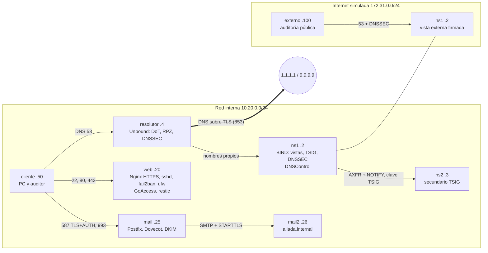

# Proyecto Formativo — DNS moderno e infraestructura web segura para la Cooperativa Jesús Nazareno

Proyecto socioformativo de Tecnología Web I (UPDS), grupo Ubuntu. Se diseña e implementa en un laboratorio Docker la infraestructura de una organización de Santa Cruz (la Cooperativa Jesús Nazareno) con el **DNS como eje**: BIND9 primario y secundario con vistas interna y externa, DNSSEC, TSIG, resolutor con DNS sobre TLS y RPZ, zona pública como código con DNSControl y, sobre ese DNS, sitio web con HTTPS, SSH endurecido y correo autenticado, con operación (firewall, fail2ban, reportes, respaldos y monitoreo). Todo se levanta con un solo comando y se verifica con dos auditorías del curso y un verificador propio.

> El dominio real de la organización solo se diagnosticó con datos públicos; en el laboratorio se usan `nazareno.internal` (zona interna) y `nazareno.example` (zona pública, dominio reservado para documentación). No se toca ningún sistema real.

## Arquitectura



Los nueve nodos usan la misma imagen (`Dockerfile`: Ubuntu 24.04 con systemd y todo el software); cada uno instala solo su rol con `scripts/instalar_*.sh`. El repositorio se monta en `/lab` (solo lectura) y `compartido/` (CA, claves TSIG y DKIM) en `/compartido`.

## Requisitos

- Docker Engine (Linux o WSL) con Compose v2, permiso para contenedores `privileged` y cgroup v2.
- Subredes `10.20.0.0/24` y `172.31.0.0/24` libres, unos 4 GB de RAM libres e internet en el primer arranque (paquetes y DNSControl).
- Git y Bash. En Windows, clonar dentro del sistema de archivos de WSL (no en `/mnt/c`).

## Inicio rápido

```bash
git clone https://github.com/TW1-GrupoUbuntu/Proyecto_Formativo.git
cd Proyecto_Formativo
bash scripts/levantar.sh          # construye la imagen, instala todos los roles y publica DKIM
bash scripts/verificar.sh         # auditorías del curso + pruebas propias
```

Resultado esperado: auditoría interna ≥ 90 %, auditoría pública 100 % y `Resultado: N de N comprobaciones correctas`. Otros comandos: `bash scripts/reconstruir_nodo.sh <nodo>` (reconstruye un nodo desde cero), `bash scripts/cambio_dns.sh` (procedimiento de cambios de la zona pública) y `bash scripts/limpiar.sh` (borra todo).

Notas de seguridad: las contraseñas de buzones y de los reportes se generan al azar en `compartido/` (permisos 600) y no se suben; tampoco las claves de la CA, TSIG o DKIM (`.gitignore`). La CA y las claves del laboratorio son de demostración.

## Estructura

| Ruta | Contenido |
|---|---|
| `Dockerfile`, `docker-compose.yml` | Imagen única y los ocho nodos (`ns1`, `ns2`, `resolutor`, `web`, `mail`, `mail2`, `cliente`, `externo`) |
| `dns/` | BIND: `named.conf*` de ns1 (vistas, TSIG, `dnssec-policy`) y ns2, y las zonas interna, inversa, aliada, pública vista desde adentro y dinámica |
| `dnscontrol/` | La zona pública `nazareno.example` como código (`dnsconfig.js`, `creds.json`) |
| `resolutor/` | Unbound: stub-zones, DNSSEC, DNS sobre TLS y RPZ con reglas propias |
| `web/`, `ssh/` | Nginx (HTTPS, HSTS, CSP, redirección), sitio de prueba, sshd endurecido, aviso legal y fail2ban |
| `correo/` | Postfix, Dovecot, OpenDKIM y OpenDMARC (plantillas) |
| `operacion/` | ufw, respaldos con restic y simulacro de restauración, reporte de GoAccess, vigilancia del servidor y del DNS |
| `auditoria/` | `auditar_infraestructura.sh` y `auditar_publico.sh` del curso |
| `scripts/` | `levantar.sh`, `verificar.sh`, instaladores por rol, CA, `cambio_dns.sh`, `reconstruir_nodo.sh`, `limpiar.sh` |
| `docs/` | `MANUAL_OPERACION.md`, `INFORME_AUDITORIA.md` (generado por la auditoría) y `PLAN_ADOPCION.md` |

## Qué demuestra cada parte

- **DNS:** vistas (el mismo nombre responde distinto dentro y fuera), secundario con TSIG y NOTIFY, sin recursión ni versión visible, DNSSEC con `delv` (positivo y NXDOMAIN), zona pública con `dnscontrol check → preview → push`, y un procedimiento de cambios con serial, TTL y revisión en Git.
- **Seguridad e integración:** resolutor con DoT (el tráfico sale por el 853, no por el 53) y RPZ, DNS dinámico con `nsupdate` autenticado con TSIG limitado a una zona, y servicios que responden por nombre: HTTPS con la CA interna, SSH por clave y correo con `dkim=pass` en el destino.
- **Operación:** `ufw` (solo 22, 80 y 443), fail2ban, actualizaciones automáticas, GoAccess con acceso protegido, respaldos con restauración probada, temporizadores de vigilancia y el manual de operación.
